\# HireLens AI — Resume Screening and Job Recommendation System


HireLens AI is an AI-assisted recruitment platform designed to simplify the hiring process by analyzing resumes, identifying candidate skills, calculating job match scores, and recommending relevant job opportunities.


The platform provides separate interfaces for job seekers and recruiters, helping candidates discover suitable positions while enabling recruiters to manage job postings and evaluate applicants efficiently.


\## Features


\### Job Seeker

\- User registration and secure login.

\- Upload PDF resumes for automatic text extraction.

\- Identify technical skills from uploaded resumes.

\- View job match scores and matching or missing skills.

\- Receive job recommendations based on skills and location.

\- Save jobs for future reference.

\- Apply for jobs and track application status.


\### Recruiter

\- Recruiter registration and authentication.

\- Create, update, and manage job postings.

\- Activate or deactivate job listings.

\- View applicants for posted jobs.

\- Monitor recruitment and application information through a dashboard.


\## Technologies Used


| Technology | Purpose |

|---|---|

| React.js | Interactive frontend |

| Vite | Frontend development server and build tool |

| Node.js | Backend JavaScript runtime |

| Express.js | REST API development |

| MongoDB | Database for users, jobs, resumes, and applications |

| Mongoose | MongoDB data modelling |

| JWT | Authentication and protected routes |

| Multer | Resume file upload handling |

| PDF parsing library | Extract text from PDF resumes |

| CSS | User interface styling |


\## System Architecture


The application follows a client-server architecture.


1\. \*\*Frontend:\*\* React provides the user interface for job seekers and recruiters.

2\. \*\*Backend:\*\* Node.js and Express handle API requests, authentication, resume processing, and job-related operations.

3\. \*\*Database:\*\* MongoDB stores user details, job postings, resume information, saved jobs, and applications.

4\. \*\*Resume Processing:\*\* Uploaded PDF resumes are processed to extract text and identify candidate skills.

5\. \*\*Job Matching:\*\* Candidate skills are compared with job requirements to calculate match scores and identify missing skills.

6\. \*\*Recommendations:\*\* Relevant jobs are suggested using skill compatibility and location information.


\## Project Structure


```text

HireLens-AI/

├── client/

│   ├── public/

│   └── src/

│       ├── pages/

│       ├── App.jsx

│       ├── App.css

│       └── main.jsx

├── server/

│   ├── config/

│   ├── middleware/

│   ├── models/

│   ├── routes/

│   ├── package.json

│   └── server.js

├── .gitignore

└── README.md

```


\## Installation and Setup


\### Prerequisites

\- Node.js and npm

\- MongoDB running locally or a MongoDB connection URI

\- Git


\### 1. Clone the repository


```bash

git clone https://github.com/URK24AI1023/HireLens-AI---Resume-Screening-and-Job-Recommendation-System.git

cd HireLens-AI---Resume-Screening-and-Job-Recommendation-System

```


\### 2. Configure the backend


```bash

cd server

npm install

```


Create a local `.env` file containing the environment variables required by the backend, such as the MongoDB connection URI and JWT secret. Use the variable names expected by your server configuration, and do not commit real secrets to GitHub.


Start the backend using the development script configured in `server/package.json`. For example, if the script is named `dev`:


```bash

npm run dev

```


\### 3. Configure the frontend


Open another terminal:


```bash

cd client

npm install

npm run dev

```


Open the local URL printed by Vite in the terminal.


Ensure MongoDB is running and the frontend is configured to communicate with the backend API.


\## Future Enhancements


\- Advanced semantic resume-to-job matching.

\- Integration with external job portals.

\- Improved resume parsing and skill extraction.

\- Automated interview scheduling.

\- Enhanced analytics and recruitment reports.

\- Additional job recommendation and candidate-ranking techniques.


\## Repository


GitHub: https://github.com/URK24AI1023/HireLens-AI---Resume-Screening-and-Job-Recommendation-System


\## Disclaimer


HireLens AI is an academic project developed to demonstrate full-stack web development, resume processing, job matching, and recruitment workflow management.


## Application Screenshots

### 1. Job Seeker Login
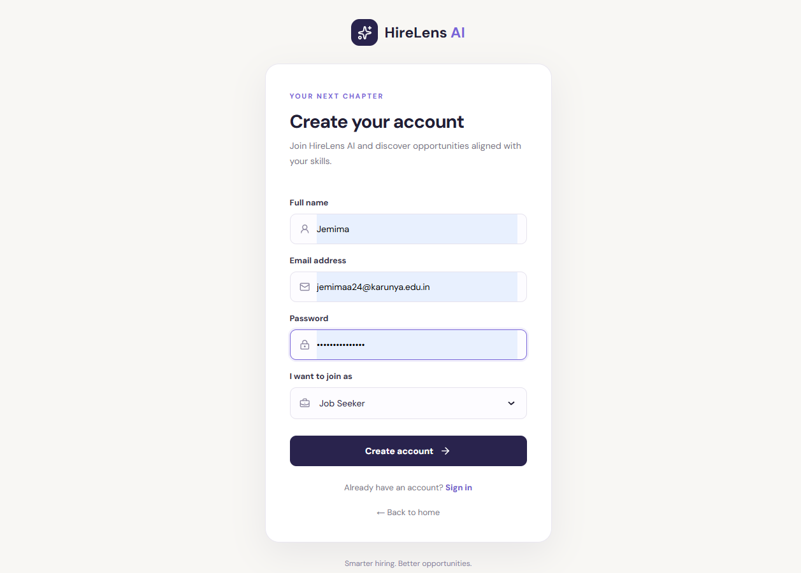

### 2. Job Seeker Dashboard
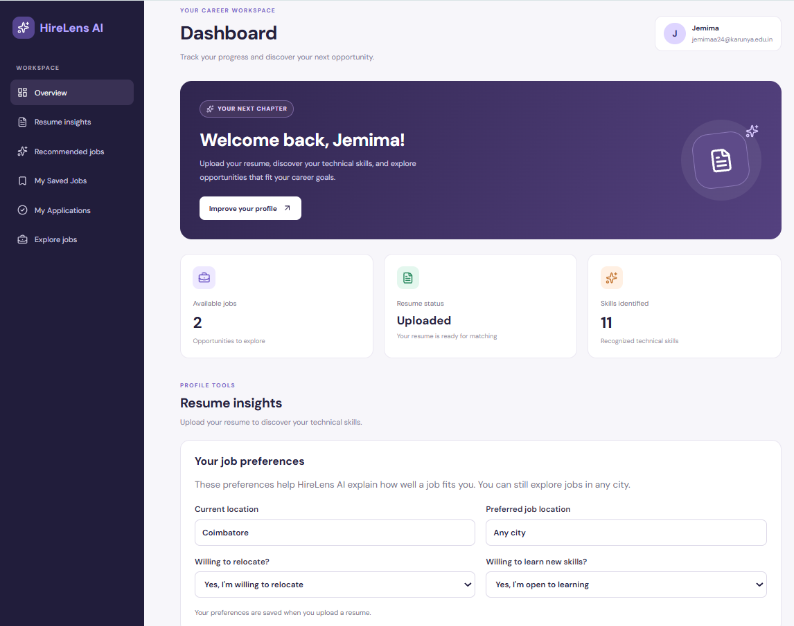

### 3. Dashboard Overview
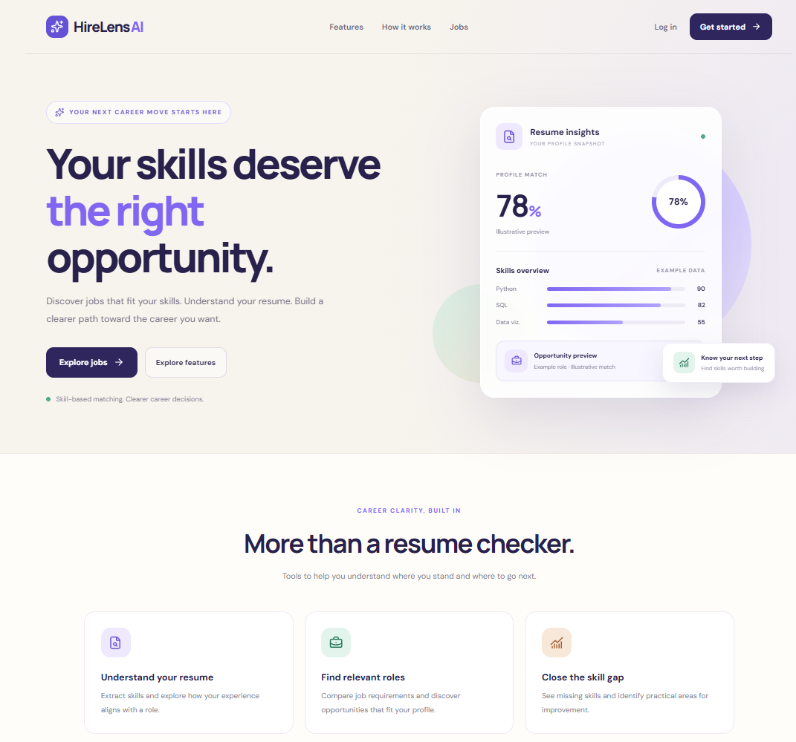

### 4. Job Recommendations
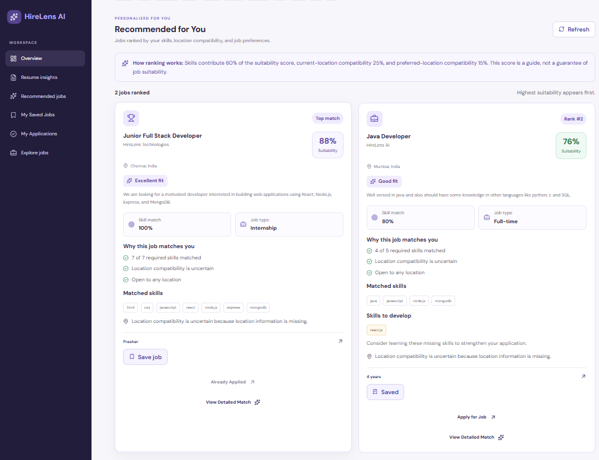

### 5. Resume Skill Matching
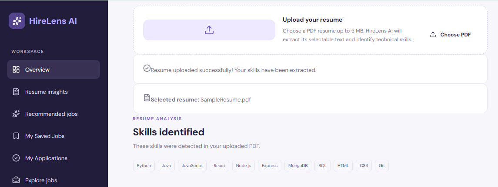

### 6. Recruiter Dashboard
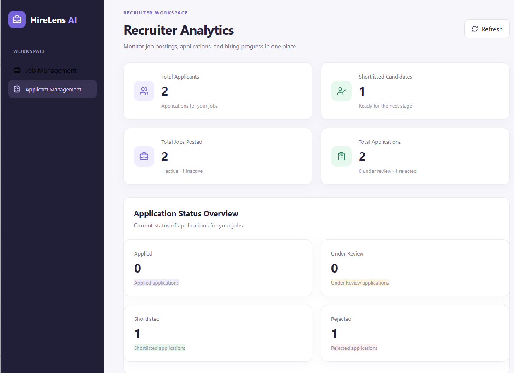

### 7. Job Posting
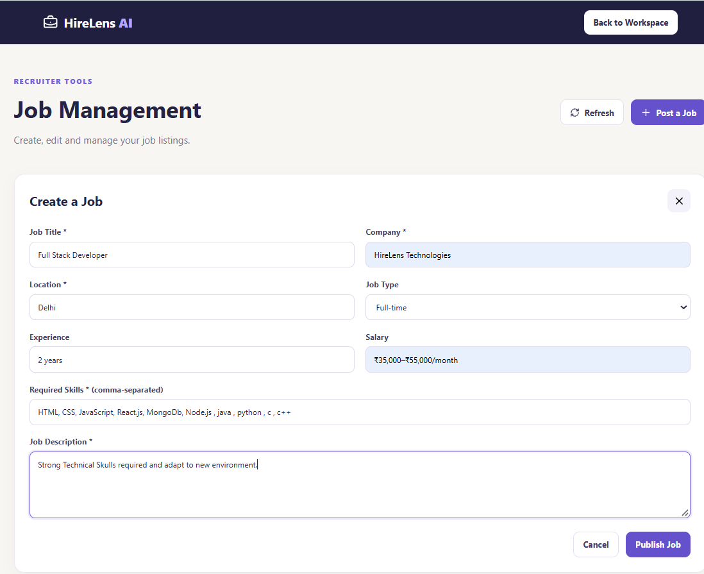

### 8. Job Management
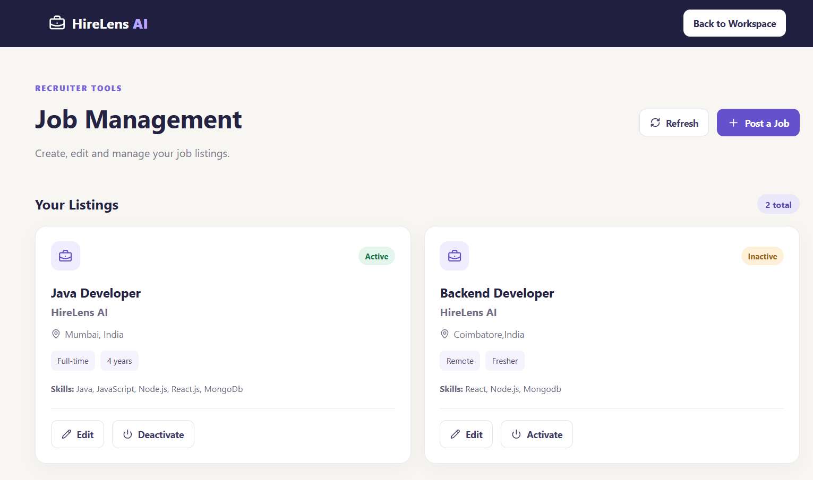

### 9. Job Applications
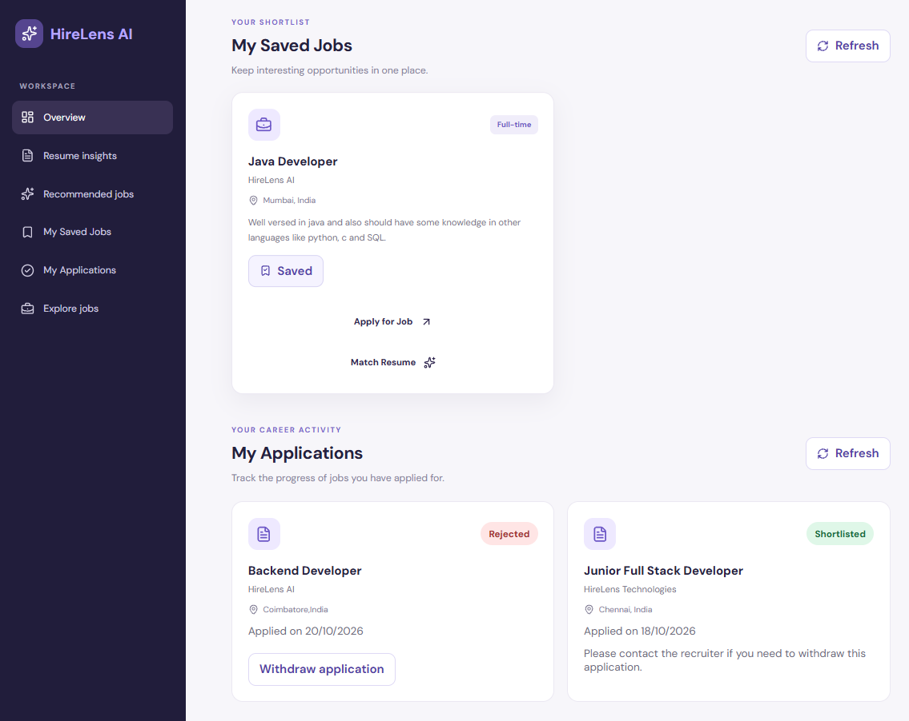

### 10. Application Status
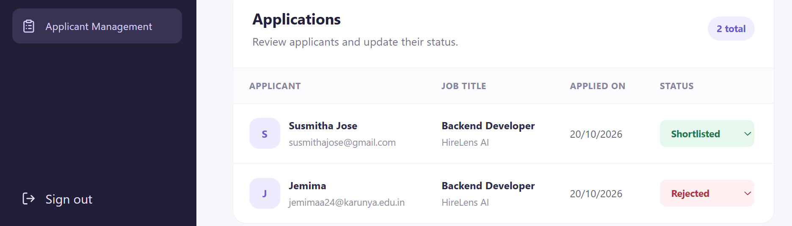

### 11. Additional Dashboard
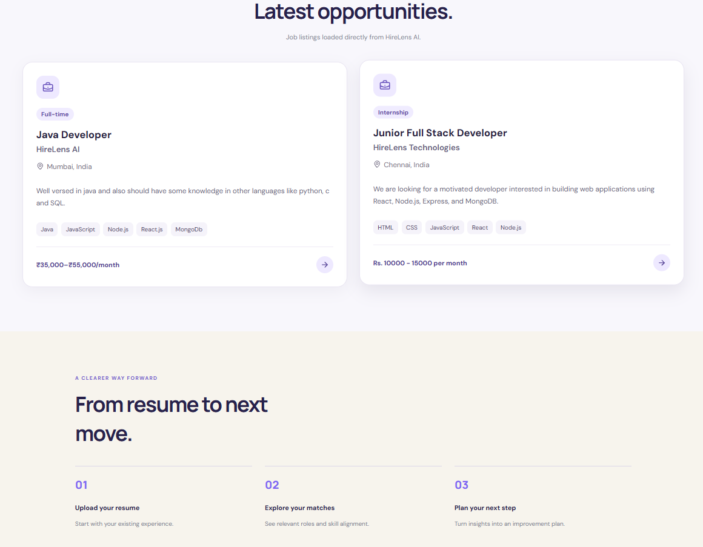


